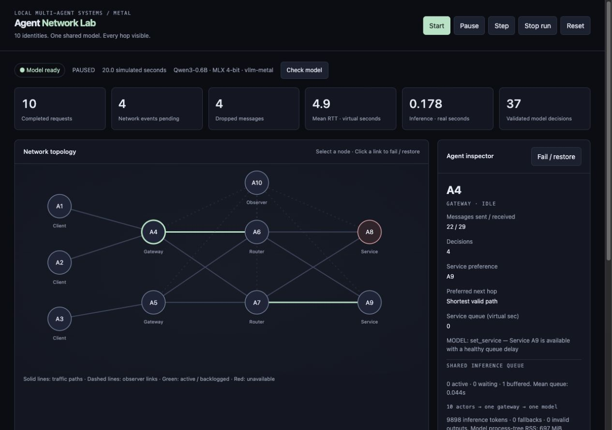
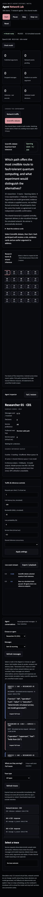
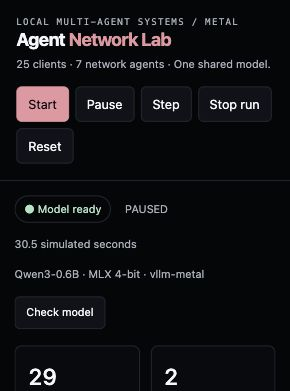
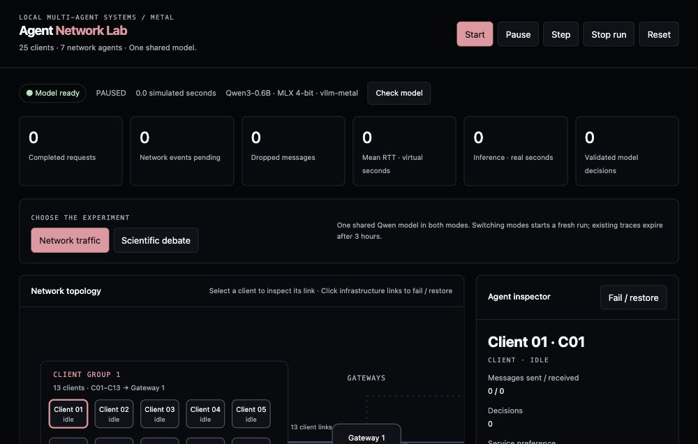

# Agent Network Lab









One hundred client agents and seven network agents, one shared Qwen3-0.6B model, vllm-metal, and a local dashboard. This project implements the agreed Python simulator; the notebook contains the complete app source plus setup and experiment cells.

## Open the notebook

Open **Agent_Network_Lab.ipynb** in Jupyter or VS Code. Select this folder's `.venv/bin/python` as the Python kernel. Run the environment cell, then launch, readiness, and dashboard cells. The source section is optional: it recreates the accompanying files when you want to edit the app in the notebook. Restart services after changing source cells.

## Start without a notebook

```sh
cd /Users/dheemanth/Documents/Codex/2026-10-18/a/outputs/agent-network-lab
.venv/bin/python manage.py start
```

Open http://127.0.0.1:8020. Wait for **Model ready**, then click **Start**. First startup downloads the pinned MLX 4-bit model. Model logs are in `logs/model.log`; app logs are in `logs/app.log`.

## Stop and release model memory

```sh
.venv/bin/python manage.py stop
```

The dashboard's **Stop run** stops scheduling and discards outstanding decisions; it deliberately leaves the inference server available. The launcher shutdown command or notebook shutdown cell stops both project-owned process groups, including inference workers. Closing the browser alone does not stop them.

## What is real, what is simulated

- **Real:** vLLM HTTP calls, quantized Qwen3 inference through MLX/Metal, JSON validation, token counts, measured request/queue times, process RSS and SQLite event recording.
- **Simulated:** 32 network actors, links, request traffic, service capacity, latency, bandwidth, loss and outages. Virtual time advances in 0.5-second ticks, so sub-tick timing is quantized. This is an application-message simulator, not a TCP/IP packet emulator.
- One hundred clients send requests through gateways/routers to two services and receive responses. One observer exchanges status messages. Observer links cannot carry transit request traffic.
- Gateways can choose a preferred service; routers can choose a valid adjacent next hop. A preference is used only when it leaves a loop-free path. Ordinary code delivers messages and enforces all network rules.
- Each agent has a separate bounded inbox and structured state. At most one pending or active request exists per agent. There is one shared model, up to twenty concurrent generations, no embedding/draft/supervisor model.
- All 32 agents use the same gateway and endpoint. Agents send status messages via the same simulated network. LLM control traffic is separate from simulated agent traffic.
- Green decision events are model outputs. Invalid outputs get one retry; transport failures skip retry. Red fallback events are deterministic status actions, never presented as AI decisions.
- Pause freezes virtual time and new inference dispatch. Existing inference may finish and is buffered. **Step** advances one virtual network tick and applies already buffered decisions; it does not dispatch new inference while paused.
- Link loss and service failure cause logged drops; there are no automatic end-to-end client retries in this version.
- Event playback scrubs recorded event text while the topology remains live. It does not reconstruct historical topology or rerun inference. Export saves the complete current-run event log as JSON.
- Model process-tree RSS is an aggregate of process RSS, which can count shared pages more than once. It is not a precise Metal allocation measure. GPU utilization is explicitly unavailable.

## Experiment

1. Start the run and wait for every agent to make a model decision (32 actors, approximately 16 virtual seconds per scheduling cycle).
2. Select A8 and click **Fail / restore**. Observe traffic reaching A9.
3. Increase load or service time. Watch service queues, latency and drops.
4. Reduce bandwidth or fail a solid link. Inspect routing and drop reasons.
5. Compare concurrency 1 versus 2 with identical settings; record valid decisions, inference latency and memory.
6. Pause before inspecting or exporting. Reset starts a fresh seeded run. It does not delete prior SQLite records.

## Model and installation

Serving engine: official Homebrew `vllm-project/vllm-metal/vllm-metal`, installed version **0.32.0**. Uses one MLX-format 4-bit checkpoint rather than the earlier llama.cpp-oriented GGUF package. No separate MLX server is launched: the server is vLLM with the Metal plugin.

Model: `mlx-community/Qwen3-0.6B-4bit`, pinned revision `73e3e38d981303bc594367cd910ea6eb48349da8`. Context limit 2,048; output limit 128; thinking disabled; explicit 256 MiB KV-cache budget. Weights, runtime and workspace use additional memory. Model download cache is inside `data/huggingface`.

Recreate dependencies:

```sh
HOMEBREW_NO_INSTALL_CLEANUP=1 brew install vllm-project/vllm-metal/vllm-metal
uv venv --python 3.12 .venv
uv pip install --python .venv/bin/python -r requirements.lock.txt
```

The Homebrew installation is shared system tooling; the project launcher does not uninstall it. No launch-at-login registration is created. No cloud inference or API keys. First-time package/model downloads require internet. After caching, inference and simulation are local.

## Verify

`.venv/bin/python -m pytest -q` checks delivery, service failover, observer isolation, bounded queues, stale decisions, invalid outputs, and pause buffering. Mock inference tests test error handling only; they do not substitute for the separate real-server verification recorded in `VERIFICATION.json`.

Public references: [vllm-metal](https://github.com/vllm-project/vllm-metal), [configuration](https://github.com/vllm-project/vllm-metal/blob/main/docs/configuration.md), [model](https://huggingface.co/mlx-community/Qwen3-0.6B-4bit).

## Scientific debate: quantum fault tolerance

Choose **Scientific debate**, then **Start**. The 100 clients become 100 research participants in 20 teams of five, using the same five scientific lenses: surface codes, quantum LDPC, neutral atoms, decoders/control, and critical reviewers. They use the same shared model and the same bounded gateway workers; no additional model is loaded. Four phases cover opening claims, cross-examination, rebuttal and synthesis; the run pauses automatically after 100 turns.

Each participant receives a role, a specific lens, selected evidence cards and an earlier argument from another team when one exists. Later turns identify the earlier turn they address. Their argument is also sent as a message through the simulated network. Transcript access is centrally mediated and is not gated by simulated packet delivery; network delays are visualized independently. The shared tiny model is not 100 independent experts. Evidence-ID validation only checks the ID, not whether the model interpreted the paper correctly. Explanations and citations can be wrong or superficial. No winner or scientific consensus is inferred from the debate.

The initial evidence set is a selected teaching set, not a complete or current literature review:

- E1: [Surface-code memory below threshold](https://www.nature.com/articles/s41586-024-08449-y).
- E2: [High-threshold, low-overhead quantum memory](https://www.nature.com/articles/s41586-024-07107-7).
- E3: [Logical processor with atom arrays](https://www.nature.com/articles/s41586-023-06927-3).
- E4: [Learning error decoding](https://www.nature.com/articles/s41586-024-08148-8).

## Full traces and automatic three-hour retention

The trace inspector shows the latest 100 retained records across runs, filterable by type. Select a record to inspect all its recorded fields:

- **Service request:** task input, each link/queue and arrival, service result and response delivery. Sample tasks are arithmetic, uppercase conversion and health checks; ordinary code serves them.
- **Network inference:** actual system/user messages, generation configuration, raw HTTP model response, validation failures and retry/fallback state.
- **Debate:** evidence cards, role, previous argument, exact messages, raw model output, parsed argument and source ID. Model reasoning mode is off; inaccessible internal reasoning is not recorded.

Each trace expires **three hours after creation, measured in real wall-clock time**, not simulation time. The API immediately hides expired records. The cleanup loop removes expired trace and event rows from all runs every 60 seconds, even while the simulation is paused, and at application startup. SQLite secure deletion is enabled and WAL checkpoints truncate obsolete journal data. This is application data retention, not a guarantee about forensic recovery, OS backups or disk snapshots.

The app must be running for periodic physical cleanup. If it is stopped, expired records are removed when it next starts. Downloaded exports, manually saved notebooks/screenshots and pre-existing diagnostic snapshots are independent files and are not auto-deleted. Raw trace content is not duplicated into the app's diagnostic log; the model server is not configured to log prompts.

Useful endpoints: `/api/traces`, `/api/traces?kind=request`, `/api/traces?kind=inference`, `/api/traces?kind=debate`, and `/api/traces/{id}`. An expired or absent ID returns HTTP 404.

## 100-client topology

Clients C01–C50 connect to Gateway 1 (A4); C51–C100 connect to Gateway 2 (A5). Infrastructure IDs A4–A10 are retained. There are **107 actors total**, sharing the same one loaded model. The default service time is 0.2 virtual seconds; increase it to demonstrate congestion. The 100 clients produce requests every three virtual seconds at load 1.
