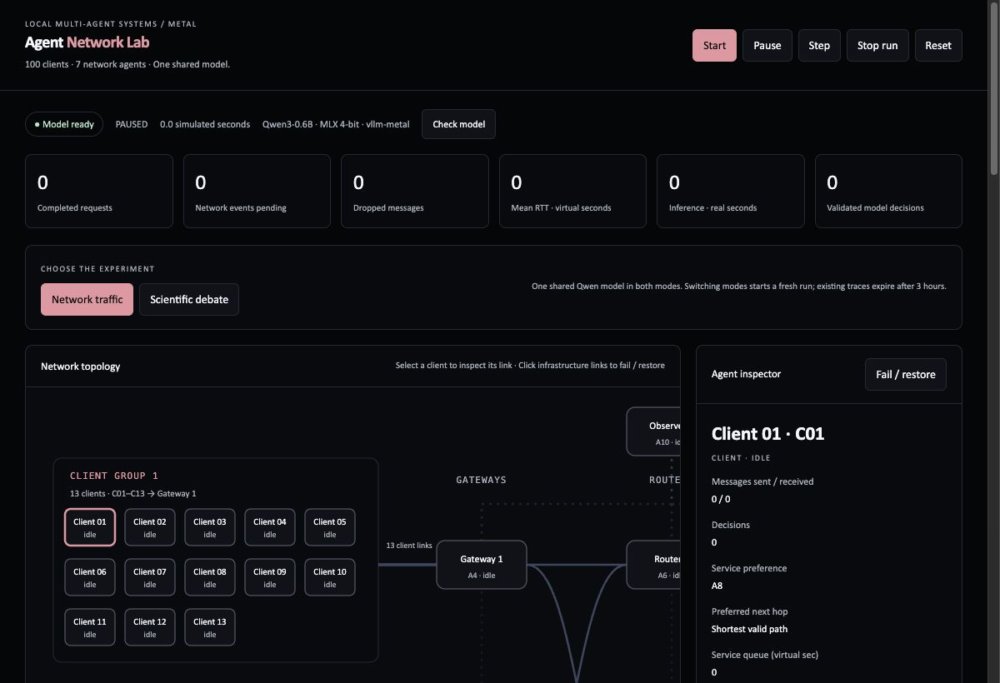
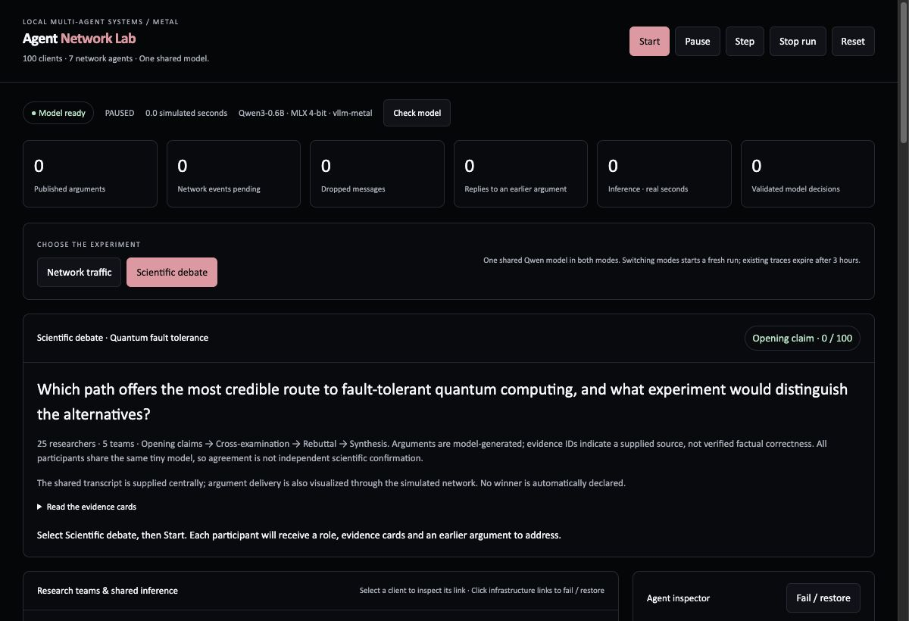
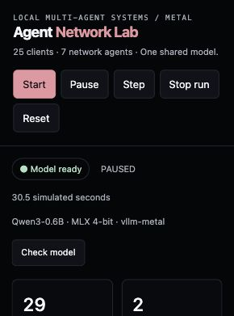
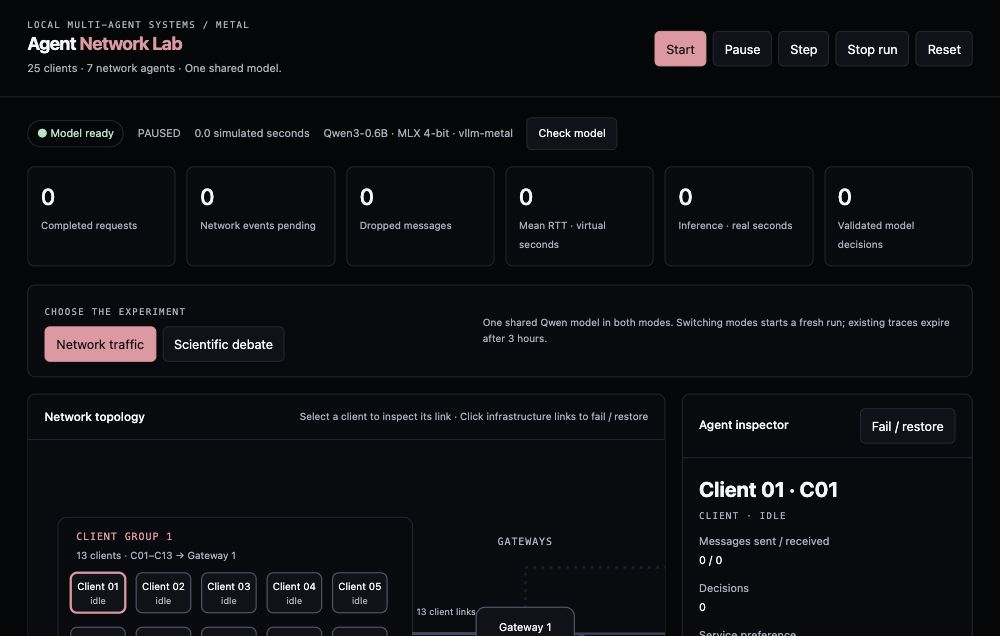

# Agent Network Lab

Local Mac learning lab for 100 simulated clients, 20 concurrent shared-model sequences, a 100-participant scientific debate, threaded traces, and a deterministic race-condition lesson.

## One-shot install

```bash
./install_mac.sh
./Start.command
```

Open `http://127.0.0.1:8020/` and `Agent_Network_Lab.ipynb` in VS Code.

The client-to-gateway traffic is simulated in memory. Model calls are real localhost HTTP requests to one `vllm-metal` Qwen3-0.6B server. Traces expire after three hours.

## Screenshots

### Dashboard and topology





### Learning controls and parallel serving




